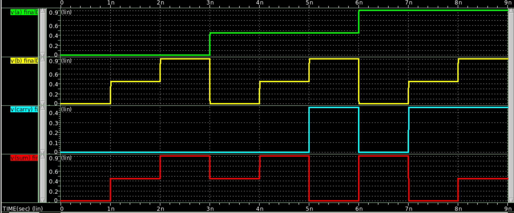
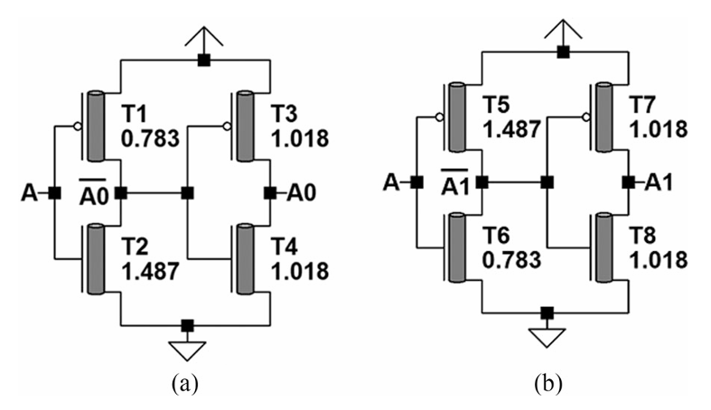
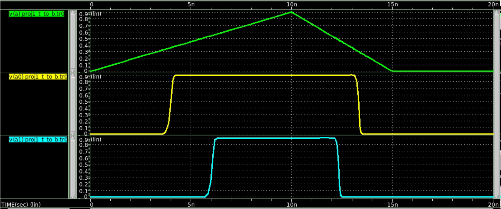
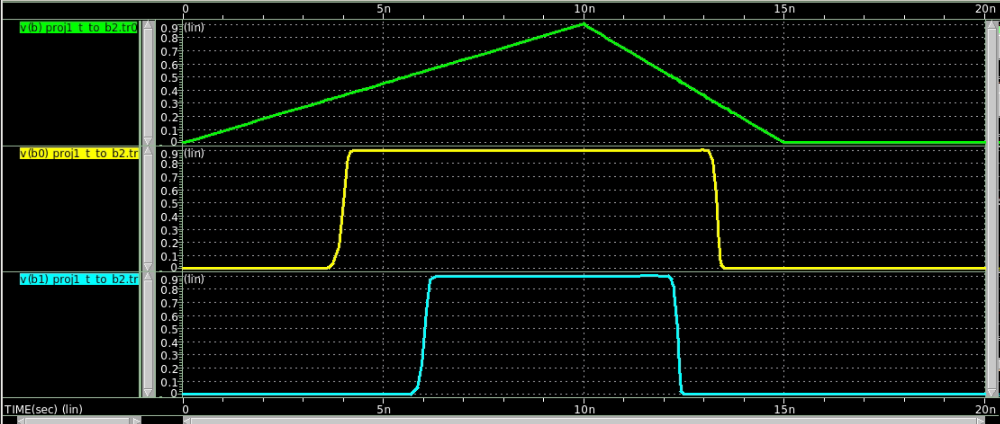
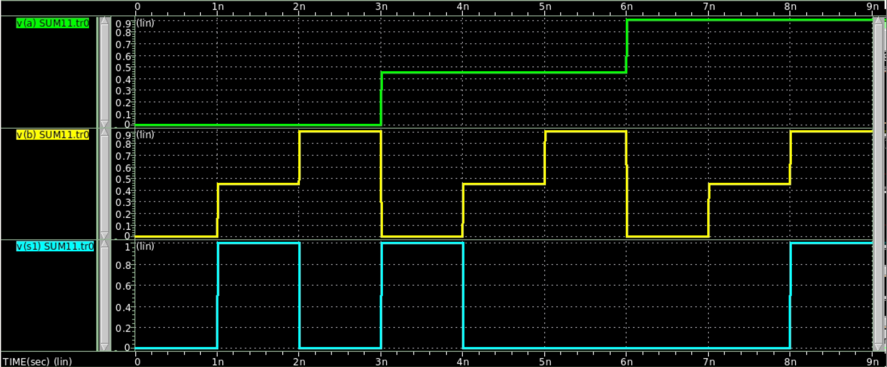
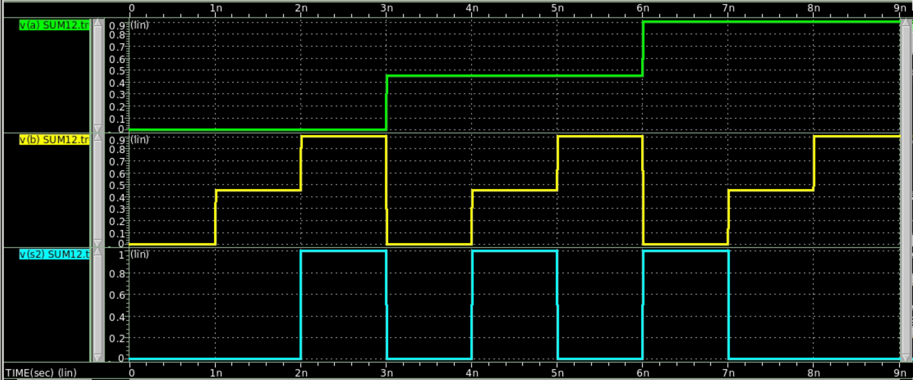
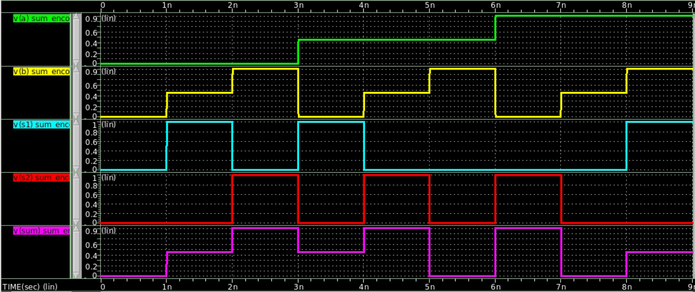
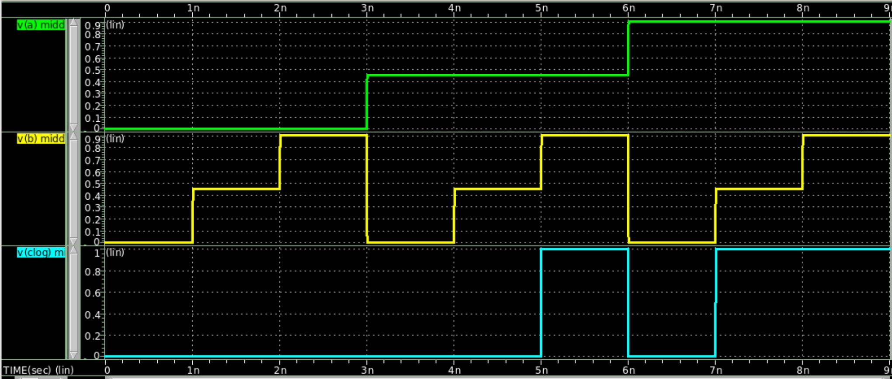

# Ternary Half Adder Using 10 nm Gate Length CNTFETs (HSPICE)

HSPICE design and simulation of a ternary half adder (logic levels 0, 1, 2) built from carbon nanotube FETs (CNTFETs) with a 10 nm gate length. The design uses a two-output ternary-to-binary decoder, binary Sum/Carry logic, and encoders that convert back to ternary. It follows the approach of Sahoo et al. [1], implemented and simulated here with the Stanford virtual-source CNTFET model.



## Highlights

- **66 transistors** in the proposed design, versus 130 in the reference design (~49% fewer)
- All **9 input combinations** verified in a transient simulation, with Sum showing three distinct levels (0 V, 0.45 V, 0.9 V)
- Every sub-block (decoder, Sum1, Sum2, sum encoder, middle carry) simulated on its own before the full circuit
- Outputs settle within each 1 ns input interval, so the propagation delay is below 1 ns (exact value still to be measured)

## Background

Ternary logic uses three voltage levels. At Vdd = 0.9 V:

| Logic level | Voltage |
|-------------|---------|
| 0 | 0 V |
| 1 | 0.45 V (Vdd/2) |
| 2 | 0.9 V (Vdd) |

A CNTFET's threshold voltage is set by the nanotube diameter, so one circuit can contain transistors with different thresholds. That is what lets the circuit tell the three ternary levels apart.

Three chiral vectors are used:

| Chiral vector | Diameter | Threshold voltage |
|---------------|----------|-------------------|
| (10, 0) | 0.783 nm | ~0.557 V |
| (13, 0) | 1.018 nm | ~0.428 V |
| (19, 0) | 1.487 nm | ~0.293 V |

## Half adder behavior

Sum = (A + B) mod 3, and Carry = 1 when A + B ≥ 3.

| A | B | Sum | Carry |
|---|---|-----|-------|
| 0 | 0 | 0 | 0 |
| 0 | 1 | 1 | 0 |
| 0 | 2 | 2 | 0 |
| 1 | 0 | 1 | 0 |
| 1 | 1 | 2 | 0 |
| 1 | 2 | 0 | 1 |
| 2 | 0 | 2 | 0 |
| 2 | 1 | 0 | 1 |
| 2 | 2 | 1 | 1 |

## Architecture

```
A ─► Decoder ─┐                 ┌─► Sum1 ─┐
              ├─► (A1,A0,B1,B0)─┤         ├─► Sum encoder ─► Sum
B ─► Decoder ─┘                 ├─► Sum2 ─┘
                                └─► Middle carry (Cm) ─► Carry encoder ─► Carry
```

**Two-output decoder.** Each ternary input becomes two binary signals:

| Input | A1 | A0 |
|-------|----|----|
| 0 | 0 | 0 |
| 1 | 0 | 2 |
| 2 | 2 | 2 |



**Sum logic**

```
Sum1 = A0'·B1'·B0 + A1'·A0·B0' + A1·B1
Sum2 = A0'·B1 + A1'·A0'·B1'·B0 + A1·B0'
```

**Carry logic**

```
Cm = B1·A0 + A1·B0
```

## Simulation setup

| Parameter | Value |
|-----------|-------|
| Simulator | HSPICE |
| Device model | Stanford virtual-source CNTFET (`vscnfet_1_0_1`) |
| Gate length (Lg) | 10 nm |
| Contact length / extension length | 11 nm / 3 nm |
| Gate oxide | 3 nm, κ = 23 |
| Supply (Vdd) | 0.9 V |
| Input rise/fall time | 20 ps |
| Output load | 1 fF |

Note: the Stanford model files are not included in this repo. Download them from the model's official source.

## Results

### Sub-block verification

| Decoder A | Decoder B |
|-----------|-----------|
|  |  |

| Sum1 | Sum2 |
|------|------|
|  |  |

| Sum encoder | Middle carry |
|-------------|--------------|
|  |  |

### Full circuit

Inputs step through all nine combinations, 1 ns each. Sum and Carry match the truth table in every interval.


### Performance

| Metric | Result |
|--------|--------|
| Transistor count | 66 (reference design: 130, ~49% fewer) |
| Settling | Outputs settle within each 1 ns input interval (propagation delay < 1 ns) |
| Exact propagation delay, power, PDP | Not yet measured |

The reference design uses a different CNTFET model and was not simulated here, so only the transistor-count comparison is made. No delay, power or PDP comparison is claimed until those are measured for this circuit.

## Limitations

- Exact propagation delay, power and PDP have not been measured yet; no speed or energy comparison with the reference design is claimed
- Verified with transient simulation of the nine input combinations only; no process-variation or temperature analysis
- No layout, as this is a device-level CNTFET study

## Future work

Extension to a full ternary adder and other ternary arithmetic blocks.

## Tools

HSPICE, Stanford virtual-source CNTFET model (`vscnfet_1_0_1`)

## Team

Parv Patidar, Shrawan Kumar Bhagat, with Dr. Manoj Kumar Majumdar, Dept. of ECE, IIIT Naya Raipur.

## References

[1] S. K. Sahoo, G. Akhilesh, R. Sahoo, M. Muglikar, "High-performance ternary adder using CNTFET," *IEEE Trans. Nanotechnol.*, vol. 16, no. 3, pp. 368–374, 2017.
[2] S. Lin, Y.-B. Kim, F. Lombardi, "CNTFET-based design of ternary logic gates and arithmetic circuits," *IEEE Trans. Nanotechnol.*, vol. 10, no. 2, pp. 217–225, 2011.
[3] C.-S. Lee, H.-S. P. Wong, "Stanford virtual-source carbon nanotube field-effect transistors model," Technical User's Manual v1.0.1, Stanford University, 2015.
